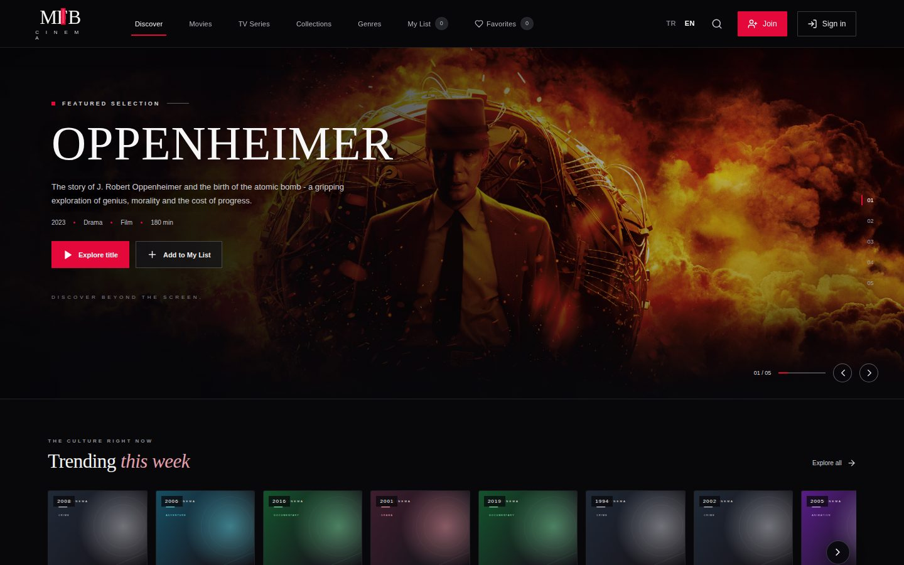
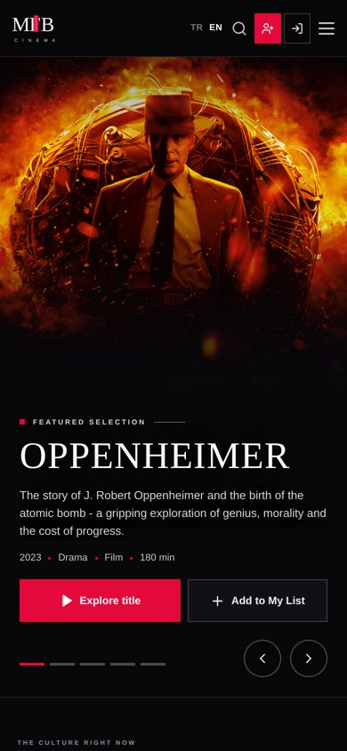
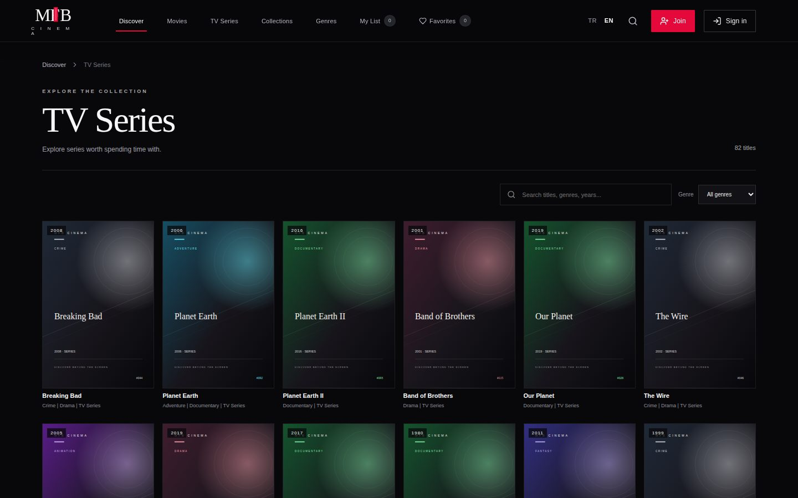
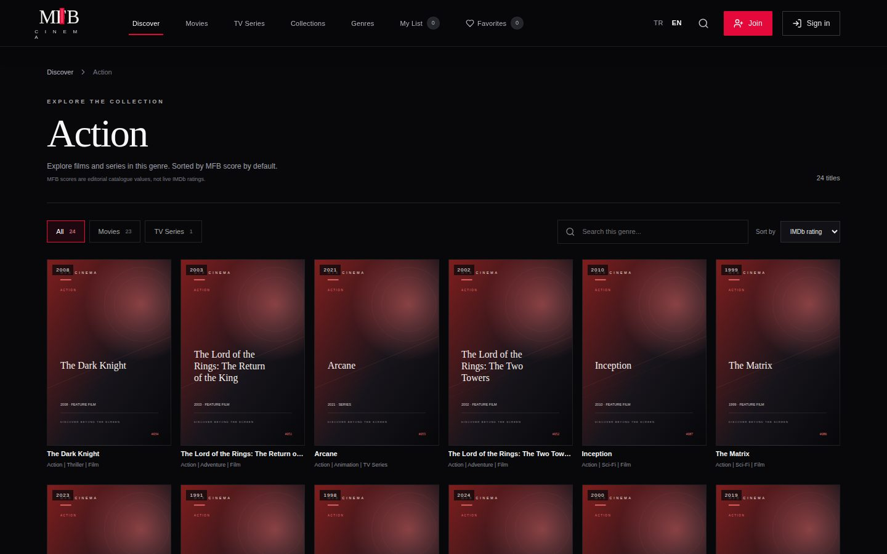

# MFB Cinema

A responsive film and series discovery app. Browse a curated catalogue by genre, search and sort titles, watch trailers, read cast details, keep a watchlist and favourites, and leave reviews. Available in Turkish and English.

**Live demo:** https://mfbcinema.vercel.app

| Home (desktop) | Home (mobile) |
| --- | --- |
|  |  |

| Series | Genre page |
| --- | --- |
|  |  |

## Features

- **Catalogue** – films and series with genre pages, search, filtering by type and sorting by rating, year or title
- **Title details** – synopsis, trailer, cast and actor profiles, streaming availability by region and similar titles (trailers, cast and providers use the TMDB API when a token is configured)
- **Accounts** – email/password sign-up, email verification, password reset, profile editing and avatar selection through Supabase Auth
- **Personal lists** – watchlist, favourites and recently viewed titles
- **Ratings and reviews** – star ratings with comments per title
- **Admin area** – add, edit and delete catalogue titles, upload posters to Supabase Storage, repair missing artwork and manage user roles
- **Hero carousel** – keyboard, button and swipe navigation; poster rails support drag and touch scrolling
- **Responsive layout** – designed for phones, tablets and desktops
- **Bilingual interface** – Turkish and English, switchable from the header

## Tech stack

| Area | Technology |
| --- | --- |
| Frontend | React 18, TypeScript, Vite, plain CSS |
| Auth, database, storage | Supabase (Auth, PostgreSQL with Row Level Security, Storage, Edge Functions) |
| External data (optional) | TMDB (trailers, cast, providers), OMDb (IMDb ratings) |
| Hosting | Vercel |
| Optional API | ASP.NET Core 8, Entity Framework Core, SignalR, xUnit |

## Project structure

```
.
├── frontend/                 React + Vite application
│   ├── public/               Avatars, hero images and local fallback posters
│   └── src/
│       ├── components/       Logo, PosterCarousel
│       ├── data/             Catalogue seed data, cast and trailer lookups
│       ├── styles/           Stylesheets, imported in order by styles/index.css
│       ├── utils/            Genre, poster and storage helpers
│       ├── App.tsx           Application shell, routing and page sections
│       ├── config.ts         Environment variables
│       ├── supabase.ts       Supabase client
│       ├── types.ts          Shared types
│       └── main.tsx          Entry point
├── supabase/
│   ├── schema.sql            Tables, Row Level Security policies, storage buckets, seed data
│   └── functions/admin-users Edge Function for admin user management
├── backend/                  Optional ASP.NET Core API (see below)
├── docs/                     Setup notes and screenshots
└── docker-compose.yml        Optional API + PostgreSQL for local development
```

## Getting started

Requirements: Node.js 18 or newer and npm.

```bash
cd frontend
npm ci
cp .env.example .env.local   # then fill in your values
npm run dev
```

The app is served at http://localhost:5173. The catalogue can be browsed without any credentials; accounts, cloud-synced lists and reviews need a Supabase project.

### Environment variables

Set these in `frontend/.env.local`.

| Variable | Required | Purpose |
| --- | --- | --- |
| `VITE_SUPABASE_URL` | For accounts | Supabase project URL |
| `VITE_SUPABASE_PUBLISHABLE_KEY` | For accounts | Supabase publishable (anon) key |
| `VITE_TMDB_ACCESS_TOKEN` | No | TMDB read access token for trailers, cast, providers and avatar choices |
| `VITE_OMDB_API_KEY` | No | OMDb key for IMDb rating lookups |
| `VITE_API_BASE_URL` | No | Base URL of the optional ASP.NET API (defaults to `http://localhost:8080`) |

> Variables prefixed with `VITE_` are bundled into the browser build. Never put a Supabase service-role key or any other server secret in them.

### Supabase

1. Create a Supabase project.
2. Run `supabase/schema.sql` in the SQL Editor.
3. Add the project URL and publishable key to `frontend/.env.local`.
4. Add your local and production URLs under **Authentication → URL Configuration**.

Step-by-step notes, including the admin Edge Function, are in [docs/supabase-setup.md](docs/supabase-setup.md).

### Scripts

Run from `frontend/`.

| Command | Description |
| --- | --- |
| `npm run dev` | Start the development server |
| `npm run build` | Type-check and create a production build in `dist/` |
| `npm run preview` | Serve the production build locally |
| `npm run typecheck` | Run the TypeScript compiler without emitting files |
| `npm run format` | Format sources with Prettier |
| `npm run format:check` | Check formatting without writing changes |

## Deployment

The frontend is deployed on Vercel.

1. Import the repository and set **Root Directory** to `frontend`.
2. Build command `npm run build`, output directory `dist`.
3. Add the environment variables listed above.
4. Add the Vercel URL to Supabase **Site URL** and **Redirect URLs**.

`frontend/vercel.json` rewrites the client-side routes (`/movies`, `/series`, `/admin`, `/turler/*`) to `index.html`.

## Optional ASP.NET Core API

`backend/MfbCinema.Api` is a standalone .NET 8 minimal API with its own PostgreSQL database, JWT authentication, catalogue and watchlist endpoints, and a SignalR hub for watch parties. Unit tests live in `backend/MfbCinema.Tests`. The deployed frontend authenticates against Supabase and does not depend on this API.

```bash
cp .env.example .env          # set POSTGRES_PASSWORD and JWT_KEY
docker compose --profile legacy-api up --build
```

The API is then available at http://localhost:8080 (health check: `/api/health`).

## Notes

- Poster and backdrop artwork in `frontend/public/posters` consists of locally generated SVG placeholders used when no remote artwork is available.
- Film titles, descriptions and trailers belong to their respective rights holders. Metadata is supplied by TMDB and OMDb where configured; this project is not endorsed or certified by either service.
