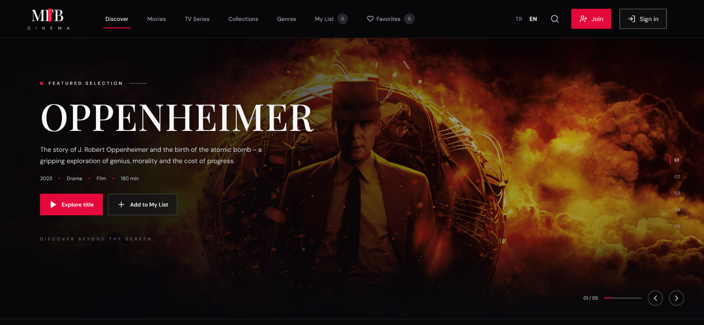
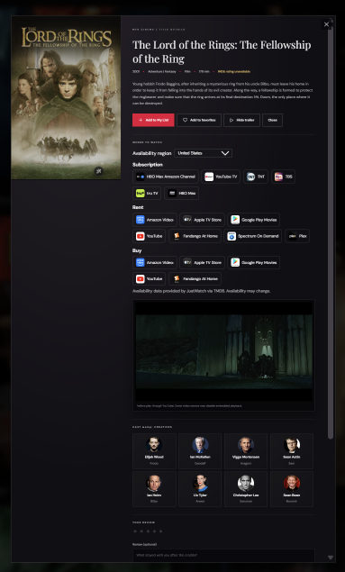
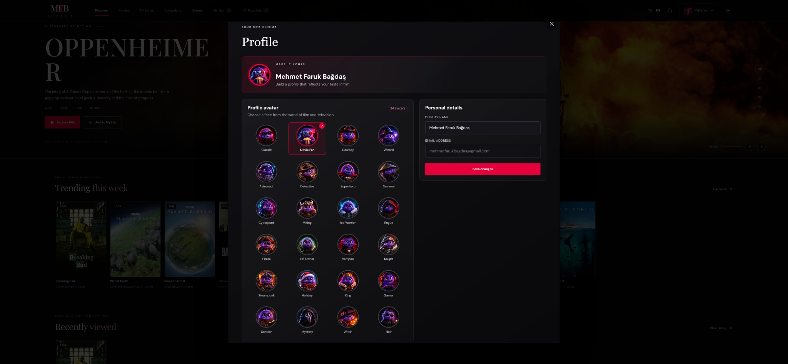
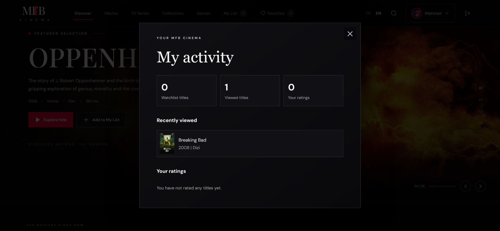
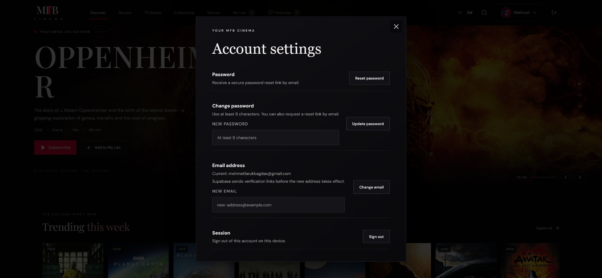
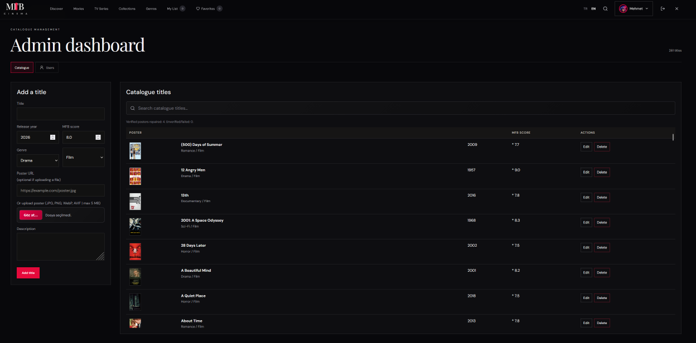
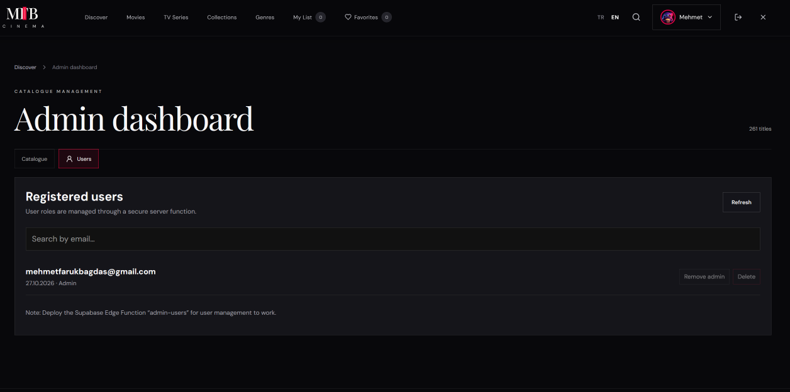

# MFB Cinema

A responsive film and series discovery app. Browse a curated catalogue by genre, search and sort titles, watch trailers, read cast details, keep a watchlist and favourites, and leave reviews. Available in Turkish and English.

**Live demo:** https://mfbcinema.vercel.app

## Screenshots

### Homepage

The main discovery page with the featured selection and curated film collections.



### Movie Details

Title information, poster, synopsis, cast, trailer and availability options.



### User Profile

Customize the display name and choose a profile avatar.



### User Activity

Recently viewed titles, watchlist activity and ratings.



### Account Settings

Password, email and session settings.



### Admin Dashboard — Catalogue Management

Manage catalogue titles and review poster, genre, release year and rating information.



### Admin Dashboard — User Management

Review registered accounts and manage admin access.



## Features

- **Catalogue** – films and series with genre pages, search, filtering by type and sorting by rating, year or title
- **Title details** – synopsis, trailer, cast and actor profiles, streaming availability by region and similar titles (trailers, cast and providers use the TMDB API when a token is configured)
- **Accounts** – email/password sign-up, email verification, password reset, profile editing and avatar selection through Supabase Auth
- **Personal lists** – watchlist, favourites and recently viewed titles
- **Ratings and reviews** – star ratings with comments per title
- **Admin area** – add, edit and delete catalogue titles, upload posters to Supabase Storage, repair missing artwork and manage user roles
- **Hero carousel** – keyboard, button and swipe navigation; poster rails support drag and touch scrolling
- **Responsive layout** – designed for phones, tablets and desktops
- **Bilingual interface** – Turkish and English, switchable from the header

## Tech stack

| Area                     | Technology                                                                   |
| ------------------------ | ---------------------------------------------------------------------------- |
| Frontend                 | React 18, TypeScript, Vite, plain CSS                                        |
| Auth, database, storage  | Supabase (Auth, PostgreSQL with Row Level Security, Storage, Edge Functions) |
| External data (optional) | TMDB (trailers, cast, providers), OMDb (IMDb ratings)                        |
| Hosting                  | Vercel                                                                       |
| Optional API             | ASP.NET Core 8, Entity Framework Core, SignalR, xUnit                        |

## Project structure

```
├── frontend/
│   ├── public/
│   └── src/
│       ├── components/
│       ├── data/
│       ├── styles/
│       ├── utils/
│       ├── App.tsx
│       ├── config.ts
│       ├── supabase.ts
│       ├── types.ts
│       └── main.tsx
├── supabase/
│   ├── schema.sql
│   └── functions/
│       └── admin-users/
│           └── index.ts
├── backend/
│   ├── MfbCinema.sln
│   ├── MfbCinema.Api/
│   │   ├── Models/
│   │   ├── Hubs/
│   │   ├── Sql/
│   │   ├── Program.cs
│   │   ├── MfbCinema.Api.csproj
│   │   ├── Dockerfile
│   │   └── appsettings.json
│   └── MfbCinema.Tests/
│       ├── CatalogRulesTests.cs
│       └── MfbCinema.Tests.csproj
├── docs/
│   └── screenshots/
└── docker-compose.yml
```

# Getting started

Requirements: Node.js 18 or newer and npm.

```bash
cd frontend
npm ci
cp .env.example .env.local
npm run dev
```
